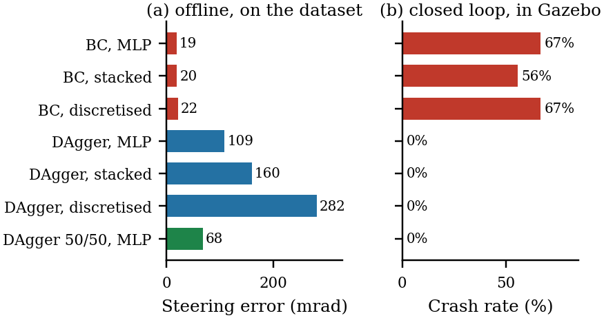
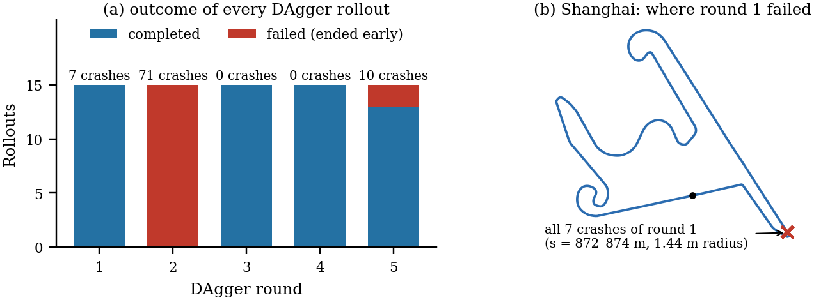
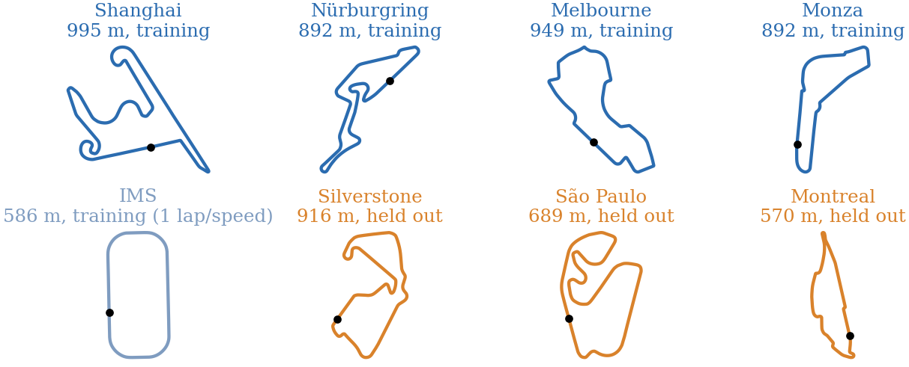

# Learning to Race from Laser Data Alone

**Imitation learning for the AgileX Hunter V2 — behaviour cloning vs. DAgger, on ROS 2 Jazzy and Gazebo Harmonic.**


[](LICENSE)

A robot cannot follow a racing line without knowing where it is, and a real robot never knows exactly — in this project wheel odometry drifted **2.29 m** while the controller reported **1 mm** of error. This repository asks whether a neural network can drive from a **2D laser scan alone** by imitating a controller that is allowed to see the robot's exact position in simulation (*privileged expert distillation*, Chen et al., [Learning by Cheating](https://arxiv.org/abs/1912.12294), CoRL 2019).

It can — and the way you measure it decides whether you notice:

- **A laser-only policy drives three circuits it has never seen without a single crash**, 0.17 m from the racing line, against the privileged expert's 0.02 m.
- **The same network trained by plain behaviour cloning crashes in 67 % of runs.** DAgger — letting the student drive while the expert labels its mistakes — is what makes the difference.
- **Offline validation error ranked the policies backwards.** Judged by agreement with the expert on recorded data, the crashing policy looks **5.6× better**. Only closed-loop evaluation revealed which one works.

<p align="center">
  
</p>

**See it drive in three commands** — trained policies ship with the repo, no dataset needed: [QUICKSTART.md](QUICKSTART.md).

---

## Contents

- [Results](#results)
- [How it works](#how-it-works)
- [Documentation](#documentation)
- [Requirements](#requirements) · [Quick start](#quick-start-docker--recommended) · [macOS](#quick-start-with-docker-on-macos-apple-silicon-or-intel)
- [Tracks](#tracks-and-the-2-scale) · [Sensing](#sensing-and-localization-phase-5) · [Dataset](#imitation-dataset-phase-6) · [Learning](#imitation-learning-phases-78)
- [Controller](#how-the-controller-works) · [ROS interface](#ros-interface) · [Benchmarking](#benchmarking)
- [Known limitations](#known-limitations) · [Troubleshooting](#troubleshooting) · [Layout](#repository-layout)
- [Citation](#citation) · [License](#license) · [Acknowledgements](#acknowledgements)

---

## Results

Each policy drove the three circuits it never saw in training — Silverstone, São Paulo, Montreal — once per training seed, at a 2.7 m/s speed cap. Nine runs per row, graded against Gazebo ground truth that the policy never sees.

| policy | crash rate | laps completed | true lateral RMS | *offline steer error* |
|---|---:|---:|---:|---:|
| **PID expert** (privileged: drives on ground-truth pose) | 0 % | 1.00 | **0.019 m** | — |
| BC + MLP | **67 %** | 0.33 | 0.332 m | *19.4 mrad* |
| BC + stacked K=3 | **56 %** | 0.33 | 0.420 m | *19.7 mrad* |
| BC + discretised | **67 %** | 0.33 | 0.407 m | *21.5 mrad* |
| **DAgger + MLP** | **0 %** | **1.00** | **0.168 m** | *108.9 mrad* |
| DAgger + stacked K=3 | 0 % | 1.00 | 0.195 m | *160.4 mrad* |
| DAgger + discretised | 0 % | 1.00 | 0.249 m | *281.9 mrad* |
| **DAgger, rebalanced 50/50** | **0 %** | **1.00** | 0.175 m | *68.1 mrad* |

Print this table from the raw runs with `scripts/show_results.sh`; every run is in [`results/eval_v1/eval_all.csv`](results/eval_v1/eval_all.csv).

**Validation loss ranked the policies backwards.** Offline, BC beats DAgger by 5.6× (19.4 vs 108.9 mrad against the expert); closed-loop, BC crashes in 67 % of runs and DAgger in none. Offline error averages over the expert's own states, almost all on the racing line; driving is decided by the states a policy reaches after its own mistakes — which only DAgger trains on.

**Architecture made no difference**, as predicted *before* training: an information-asymmetry measurement showed the current scan already determines the expert's steering (local/global action spread 0.003–0.040), so a history of scans has nothing to add.

**DAgger's mechanism was visible.** All 7 crashes of round 1 happened at one corner, Shanghai's 1.44 m hairpin. After the expert labelled those states, rounds 3 and 4 ran 30 rollouts without a crash. The record is not spotless: round 2 failed outright (15/15 rollouts, reproduced in both runs of the experiment, unexplained), and round 5 had two failed rollouts on Monza.

<p align="center">
  
</p>

**Rebalancing halves the offline gap at no cost.** DAgger rows were 75 % of the training set; forcing a 50/50 mix per batch cut the offline error from 108.9 to 68.1 mrad with an unchanged crash record. Still 3.5× BC's 19.4, so part of the trade is real: a policy trained to recover is less precise at copying a demonstrator that never needs to.

**Limits.** Simulation only — transfer to the real robot is untested. One expert, five training circuits, three test circuits. The speed cap is given to the policy as one extra input (the laser cannot tell 1.5 from 2.7 m/s on the same straight); a strictly laser-only variant is implemented but was not run.

---

## How it works

| Phase | Contents | State |
|---|---|---|
| 1–2 | Robot bring-up; track conversion — eight F1 circuits rebuilt at 2× for the Hunter's 1.31 m turning radius | done |
| 3 | Trajectory server, PID tracker, ground-truth metrics logger | done |
| 4 | Further classical controllers (Pure Pursuit, Stanley, LQR, MPC) | dropped — the PID is the expert |
| 5 | 2D LiDAR + IMU, dual EKF, AMCL localization, pose-source A/B switch | done |
| 6 | Imitation dataset: schema, recorder, episode monitor, converter, inspector, collection runner | done |
| 7–8 | Imitation learning: {BC, DAgger} × {MLP, frame-stacked, discretised}, 3 seeds, closed-loop evaluation | done |
| 9 | Transfer to the real robot | future work |

1. **The expert** — a PID cross-track controller with curvature and heading feedforward — drives on Gazebo's ground-truth pose and stays within 15–25 mm RMS of the line.
2. **The dataset** records, 20 times a second, what the laser saw (720 ranges) and what the expert commanded (steering, speed): 8 circuits × 3 speed caps, 958 k rows ≈ 13 h of driving. Five circuits train; **Silverstone, São Paulo and Montreal are held out entirely**.
3. **The student** (`policy_tracker`) subscribes to `/scan` and nothing else, so it cannot read the pose even by mistake.
4. **DAgger** lets the student drive while a shadow expert — the same control law, built with **no command publisher at all** — records what it would have done. Five rounds, 75 rollouts.
5. **Evaluation** drives every policy on the held-out circuits and grades it against ground truth; offline error is reported beside the result, never used to choose.

<p align="center">
  
</p>

---

## Documentation

| Document | For |
|---|---|
| [QUICKSTART.md](QUICKSTART.md) | Clone to a policy driving an unseen circuit, in three commands |
| [docs/PROJECT_REPORT.md](docs/PROJECT_REPORT.md) | The whole project as a standalone report: problem, method, results, the silent defects found, limitations |
| [docs/phases_6_8_simple.md](docs/phases_6_8_simple.md) | The learning phases in plain language, no machine-learning background assumed |
| [docs/phases_6_8_explained.md](docs/phases_6_8_explained.md) | Technical reference: exact numbers, bug postmortems, commands |

Figures are regenerated from the tracked results with `python3 scripts/make_figures.py`.

---

## Requirements

| Item | Version |
|---|---|
| OS | Ubuntu 24.04 Noble |
| ROS | ROS 2 Jazzy |
| Simulator | Gazebo Harmonic (gz-sim 8) |
| Python | 3.12 |
| Extra ROS packages | `control_toolbox`, `ros2bag`, `rosbag2_storage_mcap`, `robot_localization`, `slam_toolbox`, `nav2_amcl`, `nav2_map_server`, `nav2_lifecycle_manager`, `topic_tools` |
| Python packages | `numpy`, `h5py`, `pyyaml` (dataset tooling); `torch` (Phase 8, training host only) |

---

## Quick start (Docker — recommended)

```bash
docker compose build          # ~5-10 min on first run
xhost +local:docker           # once per host login, for the Gazebo/RViz GUI
docker compose run --rm dev   # interactive shell in the container
```

Inside the container:

```bash
colcon build --symlink-install
source install/setup.bash

# Full benchmark run: Gazebo + trajectory server + PID tracker + metrics
ros2 launch hunter_benchmark benchmark.launch.py

# Any of the eight tracks instead of the default IMS -- all four must agree
ros2 launch hunter_benchmark benchmark.launch.py \
    world:=Nuerburgring.sdf \
    track_file:=src/race_tracks/Nuerburgring/Nuerburgring_centerline_2x.csv \
    params_file:=nuerburgring_defaults.yaml track_name:=Nuerburgring

# No display (CI, batch collection): Gazebo server-only, no RViz
ros2 launch hunter_benchmark benchmark.launch.py headless:=true use_rviz:=false
```

That single command spawns the robot on the reference line, brings up the controllers, starts tracking, and records a rosbag plus `summary.csv` under `src/hunter_benchmark/results/`.

To run just the simulation with no controller:

```bash
ros2 launch hunter_gazebo launch_gz_sim.launch.py
```

### Host build (no Docker)

```bash
colcon build --symlink-install
source install/setup.bash
ros2 launch hunter_benchmark benchmark.launch.py
```

> Docker and host builds must not share `build/`, `install/` or `log/` — the CMake caches store absolute paths. Delete them when switching.

---

## Quick start with Docker on macOS (Apple Silicon or Intel)

Standard X11 forwarding via XQuartz has OpenGL driver compatibility issues with modern Gazebo Harmonic and RViz on macOS. Instead, use the macOS-specific configuration which runs a virtual display server (VNC/noVNC) inside the container and streams the graphical desktop directly to your web browser.

### 1. Build the macOS image

```bash
docker compose -f docker-compose.mac.yml build
```

### 2. Open a shell in the container
You **must** pass the `--service-ports` flag to map the web viewer port back to your Mac:

```bash
docker compose -f docker-compose.mac.yml run --service-ports --rm dev
```

### 3. Open the Web GUI in your browser
Open your web browser (Safari, Chrome, Firefox) and go to:
```
http://localhost:6080/vnc.html
```
Click the **Connect** button to see the virtual desktop.

### 4. Build the ROS workspace (inside the container)

```bash
colcon build --symlink-install
```

### 5. Launch the simulation

In the container terminal:
```bash
ros2 launch hunter_gazebo launch_gz_sim.launch.py
```
Look at your browser tab (`http://localhost:6080/vnc.html`) to see the Gazebo Sim and RViz windows.

### 6. Launch the controller (second terminal / second container shell)

Open a second terminal window on your Mac host and run:
```bash
# Open a second shell in the same container:
docker compose -f docker-compose.mac.yml exec dev bash

# Then run the benchmark:
ros2 launch hunter_benchmark benchmark.launch.py
```

---

## Tracks and the 2× scale

Eight circuits from [f1tenth_racetracks](https://github.com/f1tenth/f1tenth_racetracks), all used at **2× scale**. Adding another is two commands:

```bash
python3 src/scale_track.py <Track> 2.0
python3 src/my_convert_track.py <Track>/<Track>_map.png <Track>/<Track>_map_2x.yaml \
    -o hunter_gazebo/worlds/<Track>.sdf --smoothness 0.0003 --thickness 0.06
```

The map PNG is never modified — scaling is expressed as a larger `resolution` in the map YAML, with `origin` scaled to match. Lengths (x, y, arc length, track widths) scale by the factor, curvature scales inversely, angles are untouched.

**Why scale at all?** F1TENTH circuits are drawn for ~0.3 m-long 1/10-scale cars, while the Hunter V2 is 0.98 m long with a **1.31 m minimum turning radius**. Two independent reasons:

- *Kinematic* — corners tighter than 1.31 m are undrivable at any speed.
- *Margin* — wheel odometry drifts without bound, so the corridor must absorb pose error the controller cannot see.

The 2× factor is also what makes the tracks *proportionally* like F1 for this car: a Hunter lap of Nuerburgring 2× is 910 car-lengths, an F1 lap of the real circuit is 1,029.

| Track | Length | R_min (smoothed) | Wall clearance | Margin | Speed limit binds | Min speed |
|---|---:|---:|---:|---:|---:|---:|
| Shanghai | 995 m | **1.44 m** | 2.22 m | 1.84 m | **22.6 %** | 0.63 m/s |
| Nuerburgring | 892 m | 2.74 m | 2.08 m | 1.71 m | 21.9 % | 1.00 m/s |
| SaoPaulo | 689 m | 3.17 m | 2.11 m | 1.73 m | 21.3 % | 1.09 m/s |
| Silverstone | 916 m | 2.61 m | 1.85 m | 1.48 m | 21.0 % | 0.96 m/s |
| Montreal | 570 m | 2.20 m | 1.03 m | **0.66 m** | 18.6 % | 0.87 m/s |
| Melbourne | 949 m | 2.51 m | 2.10 m | 1.73 m | 12.4 % | 0.94 m/s |
| Monza | 892 m | 2.21 m | 1.75 m | 1.37 m | 10.8 % | 0.87 m/s |
| IMS | 586 m | 28.07 m | 1.87 m | 1.50 m | **0 %** | 2.70 m/s |

"Speed limit binds" is the fraction of the lap where the curvature-limited profile `v = sqrt(a_lat / κ)` drops below `max_speed_mps` — computed from the reference CSV alone, no simulator needed. All eight clear the 1.31 m kinematic gate. Two deserve care: **Montreal's** margin is under half the others (narrow corridor), so expect wall contact and a lower clean-lap rate; **Shanghai's** 1.44 m minimum radius is only 10 % above the physical limit.

The binding column is the reason there are eight tracks and not two. On **IMS** the profile never engages: commanded speed is a flat 2.7 m/s for the whole lap, so a dataset collected there has *zero* speed variance and would train a policy that only ever outputs one number while showing excellent loss. IMS is kept in the collection but capped at one or two laps — it teaches "open geometry = full speed" and nothing else. The other seven force real slowdowns, and the Phase 6 gate lap was deliberately run on Nuerburgring for that reason.

Split for Phase 8: five tracks train, **three are fully held out** (never seen in training), plus two held-out laps per training track. Held-out laps measure memorisation; held-out tracks measure generalisation.

| File | Role |
|---|---|
| `src/race_tracks/<Track>/<Track>_centerline.csv`, `_raceline.csv` | Upstream F1TENTH data, unmodified (Montreal and Shanghai ship no raceline) |
| `src/race_tracks/<Track>/<Track>_centerline_2x.csv` | **The reference line actually driven** |
| `src/race_tracks/<Track>/<Track>_map_2x.yaml` | Scaled map metadata used to build the world |

The **centerline** is the reference, not the raceline: the F1TENTH raceline hugs the walls by design, which a 0.745 m-wide robot cannot follow at any scale.

> The launch **aborts** if `track_file` and the world SDF were generated at different scales — a mismatch otherwise looks exactly like a controller bug, with the robot tracking its wrongly-scaled path perfectly while drifting into a wall.

---

## Sensing and localization (Phase 5)

| Sensor | Spec | Topic |
|---|---|---|
| 2D LiDAR | 270° FOV, **1080 beams**, 30 m, 20 Hz, 0.01 m noise | `/scan` |
| IMU | 100 Hz, with bias | `/imu` |

The LiDAR geometry (270°/1080/30 m) was originally chosen to match **f1tenth_gym** so a gym-trained policy would transfer without reshaping. That reason is gone — nothing is trained in gym any more — but the 1080-beam sensor stays as-is, and the **dataset observation is 720 beams**: every third raw beam (`i % 3 == 1`) is dropped, no interpolation. The sensor keeps full resolution in the bag; the 720 is a documented, reversible choice in `dataset_spec.py`, and it stands.

Frame ownership — the part that fails silently when wrong:

```
map --(AMCL)--> odom --(local EKF)--> base_link --(URDF)--> laser
```

The **local EKF** fuses wheel odometry + IMU into a continuous `odom→base_link` at 50 Hz — no jumps, which is what a controller needs. The **global EKF** consumes the localizer's absolute pose (`/amcl_pose`) and publishes the smoothed `/odometry/filtered_map`; it deliberately does **not** publish TF — exactly one publisher per transform edge.

**AMCL localizes against the track's own occupancy grid** (`src/race_tracks/<Track>/<Track>_map_2x.yaml`) — the same file `my_convert_track.py` consumed to build the Gazebo world, so the `map` frame coincides with the world frame by construction and no mapping run is needed. Measured true tracking error with AMCL on Monza: ~3 mm.

```bash
ros2 launch hunter_benchmark benchmark.launch.py slam_mode:=localization pose_source:=slam_ekf \
    world:=Monza.sdf track_file:=src/race_tracks/Monza/Monza_centerline_2x.csv \
    params_file:=monza_defaults.yaml track_name:=Monza
```

`slam_toolbox` mapping still works (`slam_mode:=mapping`) and produces a pose graph; its *localization* mode does not — see [Known limitations](#known-limitations). Pose graphs are **not in git** (over 100 MB, regenerable).

### Pose source A/B switch

`pose_source` swaps what the tracker believes, with no code change — the tracker consumes `nav_msgs/Odometry` and never looks up TF:

| `pose_source` | Topic | Use |
|---|---|---|
| `ground_truth` | `/ground_truth/odometry` | Expert driving, benchmark reference |
| `slam_ekf` | `/odometry/filtered_map` | Deployable stack (AMCL → global EKF) |
| `wheel_odom` | `/ackermann_like_controller/odometry` | Phase 3 behaviour, drifts |

---

## Imitation dataset (Phase 6)

Expert = `pid_tracker` on `/ground_truth/odometry`. Student input = `/scan` only. The dataset is D4RL-shaped HDF5 (`observations / actions / rewards / terminals / timeouts / infos/*`) so any standard imitation loader reads it.

Three schema decisions are fixed and expensive to reverse once data exists, so they live in one file with **zero ROS imports** — `hunter_dataset/dataset_spec.py` — and a test enforces that with an AST scan plus a bare-interpreter import:

| Decision | Value | Why |
|---|---|---|
| Observation | 1080 → **720** beams by dropping `i % 3 == 1`; inf/NaN → 30.0, then clip to [0.15, 30.0]; float32 | Selection, not interpolation — every beam is a real measurement. Sanitise **before** clip: `np.clip` propagates NaN |
| Rate | **20 Hz** (the scan rate), expert command paired nearest-in-time within **15 ms** | The student runs at scan rate; the 50 Hz controller is oversampled relative to it. Rows outside 15 ms are rejected and counted, never interpolated |
| Units | physical, **never normalised** — steering rad, speed m/s, ranges m | Normalisation stats belong in the checkpoint, not the data |

`actions` are `[steering_rad, speed_mps]`. `infos/` carries `timestamp_ns`, `gt_pose`, `progress_s_m`, `lap_index`, `episode_id`, `prev_action`, `dagger_beta`, `action_source` (0 = expert, 1 = expert relabel of a student state). `terminals` come from `episode_monitor`, which fires on chassis contact **or** any scan beam under `scan_contact_m = 0.4 m` (4.4× below the free-driving minimum of 1.77 m) and stamps the event with the scan's own `header.stamp` so the converter joins it by **exact** match — a miss raises.

```bash
# Record: wraps benchmark.launch.py with the sensor bridges, episode_monitor, the
# contact throttle and a 12-topic bag. Writes run_manifest.yaml BEFORE driving.
ros2 launch hunter_dataset record_expert.launch.py \
    track_name:=Nuerburgring track_file:=src/race_tracks/Nuerburgring/Nuerburgring_centerline_2x.csv \
    params_file:=nuerburgring_defaults.yaml world:=Nuerburgring.sdf \
    max_speed_mps:=2.7 run_id:=001 output_dir:=datasets/raw

# Convert: read → join (searchsorted, reports Δt median/p95/max and rejects) → write
ros2 run hunter_dataset convert_dataset datasets/raw/Nuerburgring_2.7ms_001/bag out.hdf5 \
    --manifest datasets/raw/Nuerburgring_2.7ms_001/run_manifest.yaml

# Inspect: PASS/FAIL per check, nonzero exit on any FAIL. Needs no ROS.
ros2 run hunter_dataset inspect_dataset out.hdf5
```

The inspector is deliberately loud: it prints per-action-dimension min/max/std/unique and puts a banner on any near-constant column, because a speed column that never varies trains fine and drives badly (`--expect-constant speed_mps` downgrades that to a warning for IMS). Bags keep all 1080 beams and all topics, so everything downstream of the bag is a converter re-run; only `max_speed_mps`, `scan_contact_m`, the contact-sensor placement and the track scale require re-driving.

**Collection** is one command per pass, resumable, and owns its processes by PID:

```bash
ros2 run hunter_dataset collect_dataset --plan src/hunter_dataset/config/collection_plan.yaml --pass p1
```

`collection_plan.yaml` holds the split (5 train / 3 held out), the three speeds (1.5 / 2.1 / 2.7 m/s), and the passes — each starts at a different point of the lap, because a deterministic expert's repeated laps differ only in where the standing start lands. Every run gets `run_manifest.yaml`, `effective_params.yaml` (the file the launch actually loaded, with `max_speed_mps` applied), the bag (Zstd, ~46 MB/lap), `dataset.hdf5`, `inspect.txt` and `collection_report.json`. The runner refuses to start unless `ros2 node list` and the gz daemon are empty, and asserts the same after every run.

> **Clocks.** Every node in the collection graph runs on `/clock` (`use_sim_time`). The gate lap caught the tracker on wall time: 77,349 diagnostics in 455 s of sim = 170 Hz instead of 50, and not one scan within 15 ms of a command. Beyond breaking the join, a wall timer scales the PID's effective I and D gains by 1/RTF — the expert's behaviour depended on host load. `pid_tracker` now uses `create_timer` on the node clock.

---

## Imitation learning (Phases 7–8)

**Six policies:** {BC data, DAgger data} × {MLP, frame-stacked MLP (K=3), discretised}. Compared closed-loop in Gazebo on the three held-out tracks, PID as the reference row, 3 seeds each. Validation loss is reported next to that table; where the two rankings disagree is a finding, not a nuisance.

| piece | where | what |
|---|---|---|
| `policy_tracker` | `hunter_control/scripts` | The student. Subscribes to `/scan` and **nothing else**; runs a `hunter_il` checkpoint at scan rate (median 1.5 ms, p99 7 ms on CPU); publishes the same command and diagnostics as `pid_tracker`, with every pose-derived field NaN. `controller:=policy policy_checkpoint:=<ckpt>` |
| `pid_shadow` | `hunter_control` | The DAgger labeller: the same `PidCore` law and params as `pid_tracker`, on ground truth, publishing `/expert/relabel` only. It has **no command publisher member** — a shadow that steers the robot is not a state the type can express |
| `dagger_runner` | `hunter_dataset` | Iteration *i*: train on everything so far, roll the student out on the training tracks with β = 0 while the shadow labels, respawn 10 m back after a crash (approach kept), convert. `action_source = 1`, `dagger_beta = 0` in the file |
| `il_train_all` | `hunter_il` | The six policies × seeds in one command; `bc_*` checkpoints see only `_p*` runs, `dagger_*` see everything |
| `il_diagnostics` | `hunter_il` | Before training: information asymmetry (PCA→32, k-NN 20, median local/global action std; < 0.2 healthy, > 0.4 problem, coloured onto the track), speed histogram per cap, lateral-offset coverage BC vs DAgger |
| `evaluate_policies` | `hunter_dataset` | Part E: `pid` plus any checkpoints × held-out tracks, ground-truth referenced, crash / laps / RMS with mean ± std over seeds |

Frame stacking never crosses an episode boundary: stacks are gathered through an explicit `[N, K]` index table clamped to each row's episode start (first scan repeated), and a test asserts it. Discretisation uses 21 bins per action whose edges blend quantile and uniform spacing with a minimum width (pure quantile spacing collapsed on this peaked distribution); the edges and bin centres live **in the checkpoint**.

```bash
ros2 run hunter_il il_diagnostics --data-dir datasets/raw --out diagnostics/
ros2 run hunter_il il_train_all --data-dir datasets/raw --seeds 0,1,2 --out checkpoints/
ros2 run hunter_dataset dagger_runner --plan src/hunter_dataset/config/collection_plan.yaml \
    --train-config src/hunter_il/config/train_default.yaml --arch mlp --iterations 5 --laps 1.0
ros2 run hunter_dataset evaluate_policies --plan src/hunter_dataset/config/collection_plan.yaml \
    --out results/eval_v1 --laps 2 pid checkpoints/*.pt
```

---

## How the controller works

**Principle: feed forward whatever the reference geometry already tells you; let the PID correct only the residual error.**

Steering combines a cross-track PID with two feedforward terms:

```
steering = clamp( PID(−lateral_error)
                  − heading_gain · heading_error        ← Stanley-style heading term
                  + atan(wheelbase · curvature),        ← geometric corner anticipation
                  ±max_steering )
```

Heading error is a proportional feedforward rather than a second PID: on a curving path the heading error is a persistent geometric fact, not a disturbance, so an integral term on it would wind up and overshoot on corner exit.

Speed feeds forward the profile speed with a PID trim, where the profile itself comes from curvature: `v = sqrt(a_lat_limit / |κ|)`, clamped.

Two **separate** lookaheads matter, because they need opposite lead distances:

- `curvature_preview_m` (0.3 m) — steering feedforward, must be **short**; it should describe the curve the front wheels are entering *now*. Too long and the robot steers for a corner it hasn't reached.
- `speed_preview_m` (2.5 m) — corner braking, must be **long** enough to shed speed before the corner.

### Key parameters (`src/hunter_benchmark/config/monza_defaults.yaml`)

One canonical params file is shared by every phase, so cross-controller comparisons stay meaningful.

```yaml
trajectory_server:
  max_speed_mps: 2.7             # straights
  lateral_accel_limit_mps2: 0.4  # sets corner speed via v = sqrt(a_lat/κ)
  centerline_smoothing_m: 2.8    # rounds corners within the vehicle's steering limit

pid_tracker:
  wheelbase_m: 0.65
  max_steering_rad: 0.461        # ⇒ 1.31 m minimum turning radius
  curvature_preview_m: 0.3       # steering feedforward (short)
  speed_preview_m: 2.5           # corner braking (long)
  steering_pid: {p: 1.3, i: 0.04, d: 0.25}
  speed_pid:    {p: 0.5, i: 0.3,  d: 0.0}
```

Gains are live-tunable: `ros2 param set /pid_tracker steering_pid.p 1.5`.

> **Speed vs. real hardware.** The stock Hunter 2.0 is rated 6 km/h (1.67 m/s); AgileX rates the upgraded drivetrain at 10 km/h (2.78 m/s). The URDF's traction joint limit (17 rad/s × 0.165 m wheel = 2.81 m/s) reflects the upgraded figure. Results above ~1.67 m/s assume the upgraded drivetrain.

---

## ROS interface

| Topic | Type | Direction |
|---|---|---|
| `/trajectory/reference` | `hunter_msgs/Trajectory` | trajectory_server → tracker (latched) |
| `/trajectory/path_viz` | `nav_msgs/Path` | RViz visualisation (latched) |
| `/scan` | `sensor_msgs/LaserScan` | LiDAR, 270°/1080 beams @ 20 Hz |
| `/imu` | `sensor_msgs/Imu` | IMU @ 100 Hz |
| `/ackermann_like_controller/odometry` | `nav_msgs/Odometry` | raw wheel odometry (drifts) |
| `/odometry/filtered` | `nav_msgs/Odometry` | local EKF, continuous, 50 Hz |
| `/odometry/filtered_map` | `nav_msgs/Odometry` | global EKF, map frame |
| `/ground_truth/odometry` | `nav_msgs/Odometry` | Gazebo truth — sim only, never on hardware |
| `/ackermann_like_controller/reference` | `geometry_msgs/TwistStamped` | tracker → robot |
| `/tracking/diagnostics` | `hunter_msgs/TrackingDiagnostics` | tracker → metrics, dataset |
| `/bumper_contacts` | `ros_gz_interfaces/Contacts` | chassis contact sensor (physics rate while touching) |
| `/bumper_contacts_bagged` | `ros_gz_interfaces/Contacts` | same, throttled 16:1 downstream of the bridge — the bagged copy |
| `/episode/event` | `hunter_msgs/EpisodeEvent` | `episode_monitor` → dataset; one per scan, stamped with the scan's stamp |
| `/episode/reset` | `std_srvs/Trigger` (service) | re-arm the latched terminal after a respawn |
| `/expert/relabel` | `hunter_msgs/TrackingDiagnostics` | `pid_shadow` → dataset: what the expert would have done in the student's state (DAgger) |
| `/policy_tracker/reset_stack` | `std_srvs/Trigger` (service) | clear the student's K-frame history after a respawn |
| `/amcl_pose` | `geometry_msgs/PoseWithCovarianceStamped` | AMCL → global EKF |

Two non-obvious details:

- `enable_odom_tf: false` on the wheel controller — the **local EKF** owns `odom→base_link`. Trackers consume `Odometry` directly and never look up TF, which is what makes the `pose_source` A/B a pure remap.
- Commands carry a **zero timestamp**, so the controller's 0.5 s `reference_timeout` is judged against its own clock rather than ROS↔Gazebo sync jitter. That timeout is also the de facto e-stop; there is no dedicated emergency-stop topic.

---

## Benchmarking

`metrics_logger` records to an mcap rosbag and writes `summary.csv` with frozen columns: mean/RMS/max lateral and heading error, laps completed, distance travelled, steering-command variance and reversal rate, speed error.

`summarize_run.py` recomputes the identical statistics offline from a recorded bag via a shared stats module, so later phases can reuse the pipeline without a live ROS graph.

Because `pose_source` also selects what the tracker believes, `summary.csv` reports **both** the estimator's own error and the true error against ground truth. That distinction is not cosmetic: in one run the controller reported 0.2 mm RMS while sitting 0.57 m off the line.

```bash
ros2 run hunter_benchmark summarize_run.py src/hunter_benchmark/results/<run>/bag
```

---

## Known limitations

**Wheel odometry drifts, and the controller cannot see it.** Dead-reckoned encoders accumulate slip every corner with no correction. Measured against ground truth at 2.7 m/s, the robot reached **2.29 m** of physical deviation while its own diagnostics reported **0.001 m** median lateral error. The controller is accurate; its idea of where it is, is not.

This is why `metrics_logger` reports true error separately, and why the expert in Phase 6 drives on ground truth.

**`slam_toolbox` localization mode is broken and superseded by AMCL.** Mapping works. Localization mode loads the graph, activates, and receives scans — but never publishes `/slam_toolbox/pose` or `map→odom`, so the global EKF silently degrades to IMU-aided dead reckoning. AMCL against the track's occupancy grid replaced it (`localization_backend:=amcl` is the default). Not on the critical path either way: the expert drives on ground truth and the student observes `/scan` only, so no pose estimate is needed at deployment.

**The contact sensor is chassis-only and misses wheel-first crashes.** It watches `base_link`'s lumped collision; at full steering lock the wheels reach the wall first, and `contact_count` stayed 0 in every realistic crash tested while the robot was pinned. The scan-proximity trigger (`scan_contact_m = 0.4`) is the one that actually fires in practice. Per-wheel contact sensors are a follow-up; adding them later changes what `trigger` means across datasets, so it should happen before, not during, collection.

**Gazebo contact sensors ignore `<update_rate>`** and publish at physics rate while touching (326 Hz measured). The bagged copy is throttled 16:1 downstream of the bridge; the live copy is not.

**Everything silently-failing found so far shares one signature** — every node reports healthy while the answer is wrong. Validate against Gazebo ground truth or the GUI, never from diagnostics alone.

---

## Troubleshooting

| Symptom | Cause and fix |
|---|---|
| Robot drives into a wall and stops with wheels still turning | Usually a **duplicate tracker**. Check `ros2 node list \| grep pid_tracker`; if it appears more than once, a previous run survived and both are publishing commands at 50 Hz. `pkill -9 -x pid_tracker; pkill -9 -x trajectory_server` (`-x`, not `-f`: `-f` matches the shell that invoked it) |
| Launch aborts with `TRACK / WORLD SCALE MISMATCH` | `track_file` and the world SDF were built at different scales — use the `_2x` CSV, or regenerate the world |
| `ros_gz_sim create` hangs on "Requesting list of world names" | `GZ_IP=127.0.0.1` not set; gz-transport bound to a non-loopback interface |
| Gazebo GUI doesn't appear | `xhost +local:docker` on the host |
| Gazebo crashes at startup | Set `LIBGL_ALWAYS_SOFTWARE=1`, or strip Snap/GTK env vars if launching from VS Code |
| `CMakeCache.txt` path mismatch | Mixed Docker and host builds — delete `build/`, `install/`, `log/` and rebuild |
| Controller stops after 0.5 s | Nothing is publishing to `/ackermann_like_controller/reference` (`reference_timeout`) |
| `PermissionError` writing `summary.csv` or a run directory | Files are root-owned from a container run (the container runs as root). Without sudo: `docker run --rm --entrypoint chown -v "$PWD:/w" hunter_robot:jazzy -R "$(id -u):$(id -g)" /w/results /w/src /w/datasets` |
| Branch switch blocked by untracked `summary.csv` | Same root-ownership problem; fix as above |
| `slam_toolbox` runs but publishes nothing | It is a **lifecycle** node — it must be CONFIGUREd then ACTIVATEd. A `/slam_toolbox/transition_event` topic with 0 publishers elsewhere is the tell |
| Push rejected, `GH001: Large files detected` | A pose graph or a bag got committed. Both are gitignored and regenerable |
| `convert_dataset`: "0 of N scans found an expert command within 15 ms" | The streams are on different clocks. Check `ros2 topic echo /tracking/diagnostics --field header.stamp.sec` against `/clock` — a 10-digit stamp is wall time; the node is missing `use_sim_time` |
| Two robots in the world, `hunter` and `hunter_0` | A stale model survived in the gz daemon and `-allow_renaming true` hid the collision. `gz topic -l \| grep model/hunter` before spawning; test launches use `-allow_renaming false` so this aborts instead |
| Spawner hangs on "Waiting messages on topic [robot_description]" | `robot_state_publisher` published nothing — usually a xacro parse failure with no error, e.g. `--` inside an XML comment |
| Sensor accepted, appears in the model, never publishes | The world SDF lacks the plugin (`Sensors`, `Imu`, `Contact`). Gazebo loads defaults only when *no* plugin is declared; `my_convert_track.py` is the single place they are all listed |
| `ros2 topic hz` reads 6 Hz on a 20 Hz sensor | It measures wall clock. Multiply by the real-time factor |
| `ros2 node list` shows `/metrics_logger` two or three times | Python nodes have `comm` = `python3`, so a name-based `kill` loop never touches them and a `ros2 launch` left behind keeps them alive across runs. Terminate the **launch process by PID** with SIGINT so it brings its children down; check `ros2 node list` is empty before the next run |

---

## Repository layout

```
src/
├── hunter_description/   # URDF/xacro (LiDAR, IMU, chassis contact sensor), ros2_control, RViz
├── hunter_gazebo/        # eight world SDFs (2x scale), simulation launch
├── hunter_msgs/          # Trajectory / Waypoint / TrackingDiagnostics / EpisodeEvent
├── hunter_trajectory/    # trajectory_server node
├── hunter_control/       # PidCore -> pid_tracker + pid_shadow; episode_monitor; policy_tracker (py)
├── hunter_benchmark/     # metrics, summarise script, benchmark launch, 8 per-track params, run summaries
├── hunter_localization/  # dual-EKF + AMCL + slam_toolbox configs and launch (pose graphs not in git)
├── hunter_dataset/       # schema (ROS-free), recorder, converter, inspector, collection + DAgger runners, evaluator
├── hunter_il/            # training harness: models, data loading, discretisation, diagnostics (PyTorch, no ROS)
├── race_tracks/          # the eight circuits: upstream F1TENTH CSVs + maps, and their 2x derivatives
├── scale_track.py        # uniform track scaling tool
└── my_convert_track.py   # occupancy map -> Gazebo world SDF (declares ALL world plugins)
checkpoints/final/        # the trained policies the results come from; *.pt.json = metrics per checkpoint
results/eval_v1/          # every closed-loop evaluation run (eval_all.csv + per-run reports)
datasets/raw/             # per-run manifests and collection reports (the HDF5 data itself is not in git)
diagnostics/              # information-asymmetry and coverage analyses
scripts/                  # watch_policy.sh, show_results.sh, make_figures.py, pipeline helpers
docs/                     # project report and the two Phase 6-8 explainers
media/                    # figures used in this README
docker/                   # Dockerfile + entrypoint
```

---

## Citation

If you use this code or its results, please cite it — GitHub's **"Cite this repository"** button reads [`CITATION.cff`](CITATION.cff).

## License

[Apache License 2.0](LICENSE). Copyright 2026 Spnh2000 and simaes.

`src/hunter_description` derives from the University of Lincoln's Hunter description package (Ibrahim Hroob, Hariharan Arunachalam), also Apache-2.0.

## Acknowledgements

- Track layouts: [f1tenth_racetracks](https://github.com/f1tenth/f1tenth_racetracks).
- Robot model: University of Lincoln Hunter description package.
- Method: D. Chen *et al.*, "Learning by Cheating", CoRL 2019; S. Ross *et al.*, "A Reduction of Imitation Learning and Structured Prediction to No-Regret Online Learning" (DAgger), AISTATS 2011.
